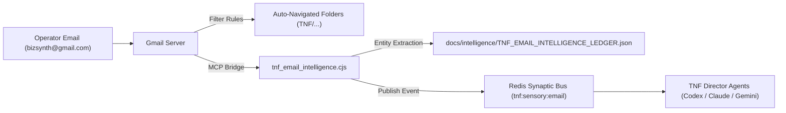

# TNF Email Intelligence Skill

## Purpose

Provides The New Fuse (TNF) with an autonomous, inbound email sensory modality
and asynchronous operator directive queue. It transforms self-sent notes,
operator prompts, and forwarded execution reports from `bizsynth@gmail.com` into
structured, machine-actionable intelligence and broadcasts them to the TNF
Synaptic Bus.

## Core Directives

1. **Non-Invasive Workspace Access:** Always communicate with Google Workspace
   via local JSON-RPC over stdio (`node dist/index.js --use-dot-names`) against
   the installed extension (`~/.gemini/extensions/google-workspace`). Never
   attempt to launch headless Chrome browsers, Playwright sessions, or
   unauthenticated CDP instances.
2. **Dual-Tier Routing Discipline:**
   - Tier 1: Client-side routing via native Gmail filters
     (`scripts/tnf-gmail-filters.xml`) ensures zero compute overhead on standard
     tags like `TNF: [Architecture]` or `TNF: [Directives]`.
   - Tier 2: Daemon classification via `scripts/tnf_email_intelligence.cjs`
     analyzes subject and body semantics, handles untagged notes, and extracts
     technical entities.
3. **Mandatory PII Scrubbing:** All emails written to `docs/` must have
   personal-provider email addresses (`@gmail.com`, `@yahoo.com`, etc.)
   sanitized to `operator@thenewfuse.com` or `[REDACTED_OPERATOR_EMAIL]` to
   satisfy `docs:pii:guard`.
4. **Synaptic Bus Broadcast:** Any incoming email triaged under `TNF/Directives`
   must be broadcast as an `AgentMessage` frame to Redis channels
   `tnf:sensory:email` and `tnf:orchestrator` to wake up active director agents.

## Category Taxonomy

The engine maintains and targets the following standardized Gmail label
containers:

- **`TNF`** (`Label_166`) — Top-level root container.
- **`TNF/Directives`** (`Label_167`) — Operator instructions, strategic
  steering, and prompt queues.
- **`TNF/Architecture`** (`Label_168`) — USAD specs, agent topologies, BEMAD
  models, master plan.
- **`TNF/Schemas-Data`** (`Label_169`) — Database SQL DDLs, pgvector models, API
  contracts.
- **`TNF/Verification-UAT`** (`Label_170`) — Readiness benchmarks, acceptance
  criteria, canary rollbacks.
- **`TNF/Ingestion-Receipts`** (`Label_171`) — Drive deep-indexing receipts,
  repo synchronization logs.
- **`TNF/Ideas-Backlog`** (`Label_172`) — Unsorted brainstorming, future
  vectors.
- **`TNF/AI-Reviewed`** (`Label_173`) — Machine marker applied to verified,
  parsed messages.

## System Architecture



## CLI Usage & Verification

To run manual or on-demand email triage across the swarm:

```bash
pnpm run tnf:email:triage
```

To verify the background daemon:

```bash
crontab -l | grep tnf-email-intelligence-triage
tail -n 20 logs/tnf_email_intelligence.log
```

To inspect the live extraction ledger:

```bash
cat docs/intelligence/TNF_EMAIL_INTELLIGENCE_LEDGER.json
```
